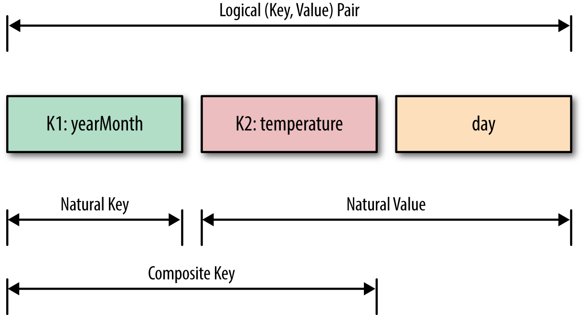

Chapter 02: Secondary Sorting
==========
The purpose of this chapter is to associate sorted 
values with reducer keys. For example, if our input has 
an ordering over values for each key as in a 
time series (a sample is given below), the values for 
each key should be sorted (e.g. by time) after reducing.

Package 
=======
org.dataalgorithms.chap02.mapreduce

Classes
=======

Class Name                   | Description                                |
---------------------------- | ------------------------------------------ | 
CompositeKey                 | Defines a composite key                    | 
CompositeKeyComparator       | Defines how a CompositeKey will be sorted  | 
NaturalKeyGroupingComparator | Defines how a NaturalKey is sorted         | 
NaturalKeyPartitioner        | Defines partitioning of NaturalKey(s)      | 
NaturalValue                 | Defines a NaturalValue                     | 
SecondarySortDriver          | Driver to submit a MapReduce job           | 
SecondarySortMapper          | Defines map()                              | 
SecondarySortReducer         | Defines reduce()                           | 

