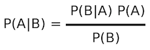

[]()

Spark Support for Naive Bayes
=============================
Naive Bayes is a simple multi-class classification algorithm with 
the assumption of independence between every pair of features. 
Naive Bayes can be trained very efficiently. Within a single pass 
over the training data, it computes the conditional probability 
distribution of each feature given a label, and then it applies 
Bayes’ theorem to compute the conditional probability distribution 
of each label given an observation and uses it for prediction 
(source: http://spark.apache.org/docs/latest/mllib-naive-bayes.html).

Using Java, Spark implements Naive Bayes by:

* ````org.apache.spark.mllib.classification.NaiveBayes```` (Trains a Naive Bayes model given an RDD of (label, features) pairs)
* ````org.apache.spark.mllib.classification.NaiveBayesModel```` (Model for Naive Bayes Classifiers)

Note
====
We provided this custom-made Naive Bayes classifier to show how a Naive Bayes classifier
can be built by simple RDD transformations for pedagogical purposes. 
